# Say Suppose: pipeline v2, a creative director's redesign

For the owner's review, 2026-11-10. A plan only: no code, config, rules or skill was changed, no paid call was made and
no gate was touched. Every change below waits for the owner's yes, one decision at a time (the list is at the end).
The same plan as a page, with the rooms-and-stages diagram: https://claude.ai/code/artifact/e0d504a4-c431-4330-8e2f-13c5dba58135

**Status (2026-11-10).** The owner accepted it ("Looks fine"). Phase 1 is built: build-order items 1, 2, 3, 4, 6, 11 and the
text half of 8, per `docs/superpowers/plans/2026-11-10-say-suppose-pipeline-v2.md`, which also records how each
decision in section 7 was taken. Items 5, 7, 9 and 10 wait for their own plans.

**What the owner asked for, in their words.** "Review should be from lens of creativity and cinematic." "Too much
reviewing can also kill a lot of things in the story sometimes right? So I don't want to go into that hole either."
"Analyse more how can we keep people hooked, like some philosophical angle or something of that sort. We need to
analyse the mindset of the people who would be clicking on this type of video." "First let's break which room is doing
what and who all people will exist in those rooms, and each room is one stage sort of, and HITL wherever required."
"Fable just needs to plan it with its creativity."

**Read for this plan.** The v1 pipeline map (artifact `32e48941`, state of main at 33c021b plus PRs #14-#17);
`CLAUDE.md`; `channels/say-suppose/` (`style.md`, `audience.md`, `taste.md`, `cast.md`, `rules/`, `room.yaml`,
`room/README.md`, `room/seats/`); `core/openmontage/pipeline_defs/studio-whatif.yaml`; the `studio-whatif-*` and
`studio-room` skills; the next-phase spec (`2026-11-09-say-suppose-next-phase-design.md`); the research notes
`docs/research/2026-11-0{6,9}-say-suppose-*`; the idea room's agreed list (`backlog/idea-room-2026-11-09.md`); and the
room trial's `RESULTS.md`, which is on branch `claude/say-suppose-room-trial` and not yet on main.

**Fixed, and not reopened here.** The seven gates G1-G7, their order, and that only the owner approves (CLAUDE.md).
No paid provider call without the owner's yes. Visuals are chosen from rendered options. A film, never slides. Banned
tools stay banned.

**Evidence this plan keeps.** GPT-5.6 on the story seat: 3 of 3 blockers agreed. The Fable director found the two
agreed problems no other seat raised (the first seven seconds, story #2; the 0:30 hook, story #3). Sonnet voice seats:
0 of 2 agreed. Grok as viewer: 2 of 3 agreed, but 675 s a round against 173 s for the persona room, and 17 of 32 calls
timed out at G1/G2 so far. A viewer-model trial is running in another session; this plan leaves the viewer's model
open until it reports.

---

## 1. Who clicks, and why they stay

### The viewer, as `audience.md` has them

Riya, 22, Pune: English-comfortable, on a phone in the evening, on the metro and then in bed before sleep, sound low,
one thumb on the screen. Exams, an internship with a boss who messages late, a mother who calls twice a day, a
grandfather with the same story. What they already daydream: pausing time before an exam, knowing what people really
think of them, money that just arrives, one more evening with someone who is gone.

### Four reasons a second-person what-if gets the tap

1. **The wish.** "I've wanted exactly this." The title grants a daydream they already had, so the click is a small
   act of permission. Psychologists who study counterfactual thinking find people enjoy simulating "what if" for its
   own sake; one account is that the pleasure is the reward for practising a useful skill (Thompson, in Pomona College
   Magazine, 2015; FitzGibbon et al., "Counterfactual curiosity", 2021).
2. **The itch.** "What would actually happen?" A rule taken seriously is a puzzle. These viewers hunt loopholes, and
   the comments under every neighbour's video are "but what about...". This is why `style.md` already asks the writer
   to list the five "but what about" questions before writing.
3. **The mirror.** "What does this say about me?" The what-ifs that travel furthest are not about powers; they are
   about the self: being seen, being judged, running out of time, losing someone, being worth something. The same
   research links counterfactual curiosity to refining one's model of oneself, and to working through regret, envy,
   relief and grief.
4. **The safe rehearsal.** "Let me feel it without it happening." At night, in bed, a what-if lets them try a loss, a
   confession or a choice at no cost. This is why a person to lose, earned, works so well (Dr. Plants' Peanut at 71%;
   the mother in the pause-time video).

### What the outliers say

From the idea room's evidence column (public YouTube search, 2026-11-09) and the topic-scoring note:

| Kind of what-if | Closest comparables found | Reading |
|---|---|---|
| **Mirror** (self, others, time, loss, worth) | "...See How Many Times You'll See..." 181K in 2 weeks (OTHERWISE); "...Everyone's Future Wealth" 1.6M in 2 weeks (ConChaser); "...Hear What Everyone Says Behind..." 198K in 5 days (IFNation); "...DELETE Your Feelings?" 1.8M (Jeitan); a world where time is money 8.4M (Story Recapped); "Dreams Are Real" 2.9M (Metaphysical) | The strongest recent pull is existential and social |
| **Power** (fly, gravity, talk to animals, invisible) | Talk to animals 73K in 3 weeks; gravity 248K on a channel that usually does more; invisible 681K (IFinity, a 10x+ outlier, but the plain title is flooded) | Spectacle still works, but plain power titles are a commodity: "a wall of uploads from the last two weeks, nearly all under 1K views" |
| **Second person with a meaning layer, done well** | Kurzgesagt's "The Egg" (Andy Weir's 2009 story, told to "you"; 2019, 8 min, two years in the making; one of the channel's most-watched videos) | A "you" story with a philosophical turn and no lecture can travel at the very top of YouTube |

Every one of batch 1's five picks is already a mirror topic (the last time you'd see someone; everyone's real odds;
paid when someone thinks of you; sell a year of your life; never forget). The idea room found the right territory on
its own. What the pipeline lacks is a way to **write the mirror on purpose** and to protect it through review.

### What makes them stay, rewatch, comment and share

| Behaviour | What earns it | Where it lives now | Gap |
|---|---|---|---|
| **Stay** past 0:30 | The promise confirmed in 7 s, then a cost and a question by 0:30 (story #2, #3) | rules, viewer and director seats | Covered |
| **Stay** to the end | An open question that grows; each use of the power has a gap; a person to care about | story #5, #6, #9 | Covered for plot; nothing asks what the film is *about* underneath |
| **Rewatch** | The stranger hidden once; the turn breaks a line already said (story #10); the last image re-reads the first | cast.md, story #10, #12 | Covered |
| **Comment** | A real dilemma put to them, with two defensible answers; a loophole left half-open on purpose; a confession prompt ("who would you call?") | style.md "the choice at 75-80%" | The choice exists, but nothing tests that it is a real dilemma rather than an obvious one |
| **Share** | One line they would send a friend; better, a film they send **to the person in it** ("this made me call my mom") | audience.md "one line they'd send" | Nobody plans the share. It is the cheapest growth lever a story channel has |

### The hooks that follow

Seven hooks, in film order. The first two and the last two exist; three are new.

1. **The wish, in 7 s.** The thumbnail's moment, inside a habit of yours (story #2, #4). Exists.
2. **The catch, by 0:30.** What you can lose and the question the film asks (story #3). Exists.
3. **The loophole, every 60-90 s (new).** The narrator answers the viewer's "but what about" one beat before they
   think it, and leaves exactly one loophole open for the comments. Keeps the itch alive between jumps.
4. **The question under the question (new).** See below. It runs underneath the plot and surfaces only twice: in the
   dilemma and in the last image.
5. **The dilemma, at 75-80% (sharpened).** A choice with two right answers, put as one narrator line; the figure acts
   at once (no held pause, no quiz board, owner 2026-11-06). Test: a cold reader can argue either side in one line.
6. **The residue (sharpened).** The last line names one real thing the viewer will see differently tomorrow, inside
   the last image (style.md). Make it a thing in Riya's week: the chai stall, the metro door, a missed call.
7. **The second watch.** The stranger and the planted line. Exists.

### The philosophical layer, without a lecture

**Most good what-ifs are a famous thought experiment in costume.** That is where the philosophical pull comes from,
and it gives the writer a lens rather than a lesson:

| Batch-1 film | The old question underneath (writer's lens, never spoken as a citation unless it is in `claims.md`) | The under-question, in Riya's words |
|---|---|---|
| The last time you'd see someone | Nietzsche's eternal return; memento mori | "If every time might be the last, how would I treat today's call from Mumma?" |
| Everyone's real odds of success | Rawls' veil of ignorance; the just-world belief | "If I saw I was 0.04%, would I still try? Would I still be kind to the ones who aren't?" |
| Paid every time someone thinks of you | "To be is to be perceived" (Berkeley); the attention economy | "Am I worth what people think of me?" |
| Sell one year of your life | Faust's bargain; time as the only currency | "What is a year of me worth, and to whom?" |
| Never forget anything | Borges' "Funes the Memorious"; forgetting as mercy | "Would I still forgive if I couldn't forget?" |
| (later) Invisible for a day | Plato's Ring of Gyges | "Am I good, or just watched?" |
| (later) Fast-forward the boring parts | Nozick's experience machine | "Is the boring part the life?" |

**How it is written.** A sixth header line, after the five lines (`rules/story.md` #1):

```
> UNDER: Would you still forgive if you couldn't forget?
```

Not spoken. It is the film's meaning, chosen by the writer at G1 and approved with the packaging. Four rules keep it
from turning into a lecture:

1. **Never stated, only staged.** No narrator line answers it. It may be *asked* once, as a question to you, and only
   at the dilemma.
2. **The plot is the argument.** Each jump of consequence makes the under-question harder, not just bigger. This is
   McKee's controlling idea, expressed through action (already on the story shelf).
3. **The last image answers it, without words** (Stanton's 2 + 2). The residue line names a real thing, not a moral.
4. **No philosopher on screen.** The lens is for the writer. If a script names Borges or Rawls, that is a real-world
   claim and needs a `claims.md` row like any other.

This adds one line to the script and no new seat. The director and the story editor read it as a suggestion lens; the
owner approves it at G1 as part of the promise.

---

## 2. Rooms as stages

One room per stage, from the idea to after release. Each room answers **one question**, has **one author** who makes
the thing, a **few named craft voices** who read it, and a **never** list that protects the story. The owner is the
showrunner: every room ends at their desk, never at a vote.

Models are suggestions from the evidence above. Where the evidence is thin, it says so.

### Room 0 · The writers' room (before G1, weekly)

- **Question.** Which daydreams carry a question our viewer already lives with?
- **Author.** None; the room pitches and the owner picks.
- **In the room.**
  | Persona | Job | Model |
  |---|---|---|
  | Three researchers | Pitch what-ifs with demand evidence | Kimi K3, Gemini 4 Argon, GPT-5.6 Sol (as PR #20) |
  | **The dreamer** (proposed) | Pitches from craft alone, no web: the wish, the mirror, the under-question | Claude Fable 5.1. It proposed or co-proposed 2 of the 5 picked films (M09, M03) in the first run |
  | Moderator | Merges, rates, proposes nothing | Claude Opus 5.5 (as PR #20) |
- **New on every pitch card:** the under-question and its thought experiment (one line each), and the kind
  (mirror, power, frame-break).
- **Never.** Drop a bet because the median is lower than the safe picks (show the spread; a wide spread is labelled a
  bet, as `rules/ideas.md` says). Score demand on plain-title floods. Pick for the owner.
- **Owner.** The weekend pick of five (unchanged).

### Room 1 · The pitch room (G1, packaging)

- **Question.** Would Riya tap this, and can the film keep the promise in 7 seconds?
- **Author.** Claude Fable 5.1 writes the premise, the five lines plus `> UNDER:`, the beat outline and three
  title-thumbnail pairs. The thumbnails are **rendered** in the channel's code look (`brand/thumbs/`), never described.
- **In the room.**
  | Persona | Reads | Model |
  |---|---|---|
  | Story editor (Pixar, Parker and Stone, McKee) | The beat outline: does it turn, do the jumps grow | GPT-5.6 Sol (3 of 3 in the trial) |
  | Director (Hitchcock) | Can the thumbnail's moment open the film; is there a 0:30 hook | Claude Opus 5.5 (the writer never reviews its own draft) |
  | Viewer, flash read | The three **rendered** thumbnails at 168x94 for 0.5 s: who, what emotion, what stake (K1, K2) | A vision model; pending the viewer trial |
  | Measuring script | K3, K4, K8-K11 by pixels; K5, K7, K12 by `title.py` and `thumb_tag.py` | No model |
- **Leaves this room.** The fact-checker: 0 blockers in 30 G1 calls; a packaging line that states a fact without a
  row becomes a lint, not a seat. (Needs per-gate seats in the room tools; today the fact role is mandatory at every
  gate.)
- **Never.** Rewrite the premise into a different film. Choose the thumbnail. Judge an image from a description.
- **Owner, G1.** Chooses one pair from the renders, and approves the five lines and the under-question with it. This
  is where the owner adds the most per minute: choosing the promise.

### Room 2 · The story room (G2, script)

- **Question.** Does it turn every beat, and does it mean something without saying it?
- **Author.** Claude Fable 5.1 writes `script.md` from the session's research and `claims.md` ("Fable just needs to
  plan it with its creativity"). The session does the research, the claims and every revision; Fable keeps the pen.
- **Order (the change that matters most).** Research and claims → Fable's draft → lint and `omni qc` → **the owner
  reads it at once** (film 2: the draft existed at 13 min and reached the owner at ~125 min) while the room runs one
  round in the background → one merged edit list (owner notes first) → one owner-notes round → G2.
- **In the room.**
  | Persona | Owns (`rules/story.md`) | Model | Why |
  |---|---|---|---|
  | Story editor | #1, #5-#7, #9, #12, the two late fails, length | GPT-5.6 Sol | 3 of 3 agreed |
  | Director | #2, #3, #8, #10; suggestions on the bomb under the table, face-thing-face, signposts, 2 + 2, and the under-question | Claude Opus 5.5 | The director brief found the opening and the 0:30 hook; that was Fable in the trial, so Opus here is unproven: measure it on films 2 and 3 |
  | Viewer | #4, #11, the viewer's week; where they would leave | Pending the trial | **Off the critical path:** a 5-minute budget; a late verdict joins as suggestions only and never holds a round |
  | Fact-checker | Every overstated or unsupported line | Gemini 3.7 Flash | Insurance: 0 blockers so far, but it runs in parallel, so it costs calls, not time, and fact blockers are never dropped |
- **Never.** Add a fact or a source. Cut a protected line (section 4). Turn the dilemma into a lesson or answer the
  under-question in words. Smooth spoken fragments into written prose (owner 2026-11-08: "written to be spoken").
  Block on taste.
- **Owner, G2.** Reads the whole script (CLAUDE.md). Sees the author's cut and the room's version side by side
  (section 4). Says yes to the narration quote in the same sitting, so G3's paid takes can start the moment G2 passes.

### Room 3 · The booth (G3, narration)

- **Question.** Does Arthur sound like someone telling you this at night, over chai?
- **Author.** Claude Fable 5.1 marks the performance: one emotion per line and the delivery directions in `say.yaml`
  (the writer knows the intent; owner 2026-11-08, "every line carries an emotion").
- **In the room.** No model seat. Sonnet voice seats were 0 of 2 on scripts, and no seat here listens to audio. The
  checks do the listening: clicks and pops, words per minute per line, gaps longer than planned.
- **New: an audition.** Before the full paid batch, the opening ten lines and the dilemma line are taken first and
  the owner hears them (the Hindi dub already works this way: "hear the opening 10 lines before paying for the rest").
  A wrong tempo or tone costs ten takes, not seventy.
- **Never.** Re-voice a line the owner locked. Change a word of the approved script (a change goes back through G2's
  owner-notes round).
- **Owner, G3.** Listens to the audition and any flagged line, then locks. The whole narration is heard again inside
  the G4 cut.

### Room 4 · The cutting room (G4, rough cut)

- **Question.** Is it a film, not slides?
- **Author.** The build session turns each `> SCENE:` into code from the kit (Claude Opus 5.5, as today).
- **New: a look test first.** Before the full build, the one picture only this premise can show (story #8) is
  rendered in two or three ways as stills or 5-second clips, and the owner picks one. Visuals are decided from renders
  (owner rule), and this is the shot the thumbnail and the film hang on.
- **In the room** (the frame-pack room the next-phase spec planned; QA before the owner's watch, never an approval).
  | Persona | Reads | Model |
  |---|---|---|
  | Slide detector | Frame difference per 2-s window, longest hold, shots per minute, text boxes against face boxes | Script, no model |
  | Director | A frame every 2 s with the timed transcript: shot variety, face-thing-face, the rule device, the bomb under the table | Claude Opus 5.5 (vision) |
  | Editor | The same pack: where the cut sags, where a beat lands late, where talk runs over a still | GPT-5.6 Sol (vision); the story eye that was right 3 of 3 |
- The animator's brief returns here as suggestions; its countable rules (change every 2-4 s, holds under 6 s, text off
  faces) move into the slide detector.
- **Never.** Restage a shot the owner picked in the look test. Ask for AI images or clips. Re-cut for pace a beat the
  owner protected.
- **Owner, G4.** Watches a 720p cut (one 1080p render is kept for G6). Says yes to the music quote in the same sitting.

### Room 5 · The scoring stage (G5, edit, music and mix)

- **Question.** With the music muted, does the sound still tell the story; with it on, does it follow the story?
- **Author.** The composer: the session writes the spotting in `cues.yaml` (intent, in and out on named cues) and
  builds the score and mix.
- **In the room.** Checks, not seats: loudness, clicks, opening, similarity (as today), plus two from `rules/sound.md`
  that a script can measure: music changes at or after a reveal (cue times against `words.json`) and the level under
  the voice. The muted-music render is produced for the owner, not judged by a model.
- **Never.** Change the music level without the owner's A/B by ear (owner 2026-11-08; `rules/sound.md` #4). Add a
  braam or a riser. Hide the channel signal inside another cue.
- **Owner, G5.** Watches the diff from the G4 notes and judges any music A/B by ear. Once two films share a level the
  owner liked, it becomes the channel default and G5 stops asking about level unless a film needs a change.

### Room 6 · The screening room (G6, final watch)

- **Question.** Does a cold viewer feel it at 1x?
- **In the room.** The owner and cold viewers, humans only. Models stay silent here by design.
- **New: one line per cold viewer.** Where they looked away, laughed, asked a question or reached for the phone. It
  goes into `taste.md` with the date, and it is the best evidence the channel will ever get before release.
- **Owner, G6.** Watches at 1x; the media proof covers the exact file (unchanged).

### Room 7 · The publish desk (G7)

- **Question.** Does the package promise exactly what the film delivers?
- **Author.** The session writes `publish.md` and `upload.yaml` while the G6 render runs, so G6 and G7 can be taken in
  one sitting.
- **In the room.** Checks: the six G7 checks, plus K13 (the thumbnail's moment by 0:30), now measurable from the
  final timeline. The pinned comment is the film's dilemma, asked as a question; the comments answer it.
- **Never.** Change the title, description, tags, kids or AI answer after the owner signs (the approval signs the
  metadata).
- **Owner, G7.** Signs the file and metadata; asks for the private upload by name; flips public by hand in Studio.

### Room 8 · The reading room (after release)

- **Question.** What did viewers just tell us, and where does it go?
- **In the room.**
  | Persona | Job | Model |
  |---|---|---|
  | Analyst | 24-hour and 7-day reads: impressions, CTR, retention at 0:30, the biggest dips mapped to script lines, average view %, shares | Script plus any model to write it up |
  | Comment reader | Sorts comments into "but what about" (next script's list), dilemma answers (which side won), confessions (the mirror worked), and topic ideas (next writers' room) | Claude Opus 5.5 |
- **Output.** One page per film: three things we learned, each tied to a script line or a frame. Read by the owner at
  the weekend beside the writers' room.
- **Never.** Change a rule from one film's numbers. Rules change only by the owner's dated note.

---

## 3. Where the owner comes in

Eleven touch points today. The plan keeps every gate and its order, keeps the owner-only approvals, and moves the two
spend approvals to the sitting before so the agent never waits on a second reply.

| Sitting | Touch | What the owner does | Value of the owner's minute | Change |
|---|---|---|---|---|
| Weekend | Pick five | From the writers' room list, with the under-question on each card | **Highest**: decides what films exist | Under-question added |
| A | **G1** | Picks a rendered pair; approves the five lines and `> UNDER:` | **High**: the promise | Renders, not text; fewer seats |
| A | **G2** | Reads the script the moment it passes lint and qc; notes; approves | **Highest**: the story | Owner first; one room round; author's cut beside it |
| A | Spend: narration | Yes to the quote | Low | Moved here from before G3 |
| B | **G3** | Hears the audition (opening ten lines and the dilemma), then locks | Medium | Audition replaces listening to every take |
| B | Look test | Picks one of 2-3 renders of the premise's key shot | **High**: the look | New, inside the G4 stage, not a gate |
| B | **G4** | Watches the 720p cut; notes | **High**: is it a film | Frame-pack room before the watch |
| B | Spend: music | Yes to the quote | Low | Moved here from before G5 |
| C | **G5** | Watches the diff from G4 notes; A/B by ear if needed | Medium | Level becomes a channel default after two films |
| C | **G6** | 1x with cold viewers; one line per viewer | **High**: the only real audience before release | Cold-viewer line into `taste.md` |
| C | **G7** | Signs; asks for the private upload | Low, but legally the owner's | Prepared during the G6 render |
| Release | Public flip | By hand in Studio | Required | Unchanged |

**What can stop asking the owner** (decided by rule, reported in the gate summary, never a question):

- Which seat ran, how many rounds, re-runs, the call cap, model timeouts.
- Lint and title fixes, measured thumbnail checks (K3, K4, K8-K11), claims formatting.
- Any room note the writer applied that touched no protected line.
- Music level, once it is the channel default.
- Process choices the skills already settle (render scale, preview type, which still sheet).

---

## 4. Fewer but better reviews

### The principle: one author, few voices, one pass

A room's job is to find what breaks the promise, not to make the story agree with five readers. Each review raises
the floor and lowers the ceiling a little; the second and third rounds mostly lower the ceiling. So: one author per
stage, at most three voices, one pass before the owner, and the owner's notes are the only second pass.

### The limits

1. **Rounds.** At most **one** room round before the owner reads and **one** owner-notes round after. Two in all per
   gate (today: up to three rounds plus owner rounds; video 1 needed three to five owner rounds per gate).
2. **Owner first.** The draft reaches the owner as soon as lint and `omni qc` pass. The room runs beside the read; it
   never sits between the draft and the owner.
3. **Blockers.** Only failed must-pass checks block (as today). New: **at most three blockers per seat per round**,
   ranked. A seat that finds more names its worst three. The diagnosis binds; the fix is a proposal, and the writer may
   solve it another way. (The trial showed the fix's wording matters: on line 119 the owner took GPT's and Grok's fixes
   and refused the voice director's.)
4. **Suggestions.** At most three per seat, each quoting a line. A seat with no failed check returns `ok`, its keep
   lines, and nothing else.
5. **The protected spine.** Once the owner approves G1, these change only by an owner note or a fact blocker:
   - the five lines and `> UNDER:`;
   - the dilemma line;
   - the planted line and its return;
   - the stranger's moment;
   - every keep line (up to three per seat), plus up to three **darlings** the writer names and defends;
   - the spoken style itself: fragments, half-sentences, a question answered at once.
6. **The author's cut.** The writer's first draft is kept and shown to the owner beside the shipped draft, with the
   room's changes marked. If the room made it blander, the owner can see it and restore it in one note.
7. **A blandness check.** Before presenting, the writer compares its first draft with the room's version and reports,
   in three lines, what the room cost the voice: lost keep lines, lost fragments, any joke or image cut. Zero is the
   target.
8. **Silence.** Rooms say nothing about taste the owner decides from renders or by ear: the thumbnail choice, colour,
   music level, the look-test pick. The screening room has no model at all.
9. **Stop.** A round with zero new blockers ends the room. There is never a third room round. A disagreement the
   writer will not take goes to the owner as one line, not to another round.
10. **Seats earn their place.** Every blocker is marked by the owner (agreed, unsure, disagreed), as in the trial. A
    seat under one in three agreed over three films leaves; a seat with no blockers in ten calls at a gate leaves that
    gate.

---

## 5. Optimisations, ranked by payoff

Payoff weighs owner waiting time, agent time and creative quality. Effort: S (skill or config text, under a day), M
(room tools or a script, a few days), L (engine work with its own plan).

| # | Change | Time payoff | Creative payoff | Effort | Measure |
|---|---|---|---|---|---|
| 1 | **Owner first, enforced in the room tools** | ~110 min per G1/G2 (film 2: 13 min to draft, ~125 min to owner) | The owner's taste shapes round 1, not round 4 | S-M | Minutes from draft to owner; owner rounds per gate |
| 2 | **Review limits and the protected spine** (one round, three blockers, author's cut, blandness check) | A round per gate; round time falls to the slowest fast seat | Voice and darlings survive review | S (skill, `room.yaml` `rounds: 1`), M (per-seat cap, author's cut in the report) | Keep lines and fragments kept from v1 to shipped; agreed-blocker rate |
| 3 | **The meaning layer and the new hooks** (`> UNDER:`, the loophole beat, the dilemma test, the residue in Riya's week, the planned share) | None | The largest creative lever: why people comment, share and come back | S (style, rules, story lint for the header line) | Comments per 1,000 views; share of comments that answer the dilemma or confess; shares; retention in the last 20% |
| 4 | **The viewer seat off the critical path** | 8-10 min per round (Grok 675 s against 173 s) | None, if late verdicts still arrive as suggestions | S | Round time; viewer blockers agreed |
| 5 | **G4/G5 speed-ups**: beat caching, audio outside the picture, 720p previews | Hours per video (video 1: ~22 h in G4/G5, at least 9 full renders) | More notes tried, fewer settled for | L | Renders per gate; hours from G4 note to the next watch |
| 6 | **Measure every gate** (arrival, approval, note count, agreed blockers, `studio.jobs` on heavy steps) | Enables the rest | Shows which rooms help | S-M | That the table exists for film 2 |
| 7 | **Slide detector and the frame-pack room at G4** | Fewer owner rounds at G4 | Guards "a film, not slides" before the owner sees it | M | Owner G4 notes about pace, holds or "slides" |
| 8 | **The look test** for the premise's key shot | Fewer look rounds at G4 | The owner chooses the film's defining image from renders | S-M | G4 notes about the look |
| 9 | **The reading room** (24 h and 7 d reads, dips to lines, comments to the next room) | None directly | The idea room learns from real viewers; the pick gets better | M | Idea-room median against actual CTR and 0:30 retention |
| 10 | **Per-gate seats** (no fact seat at G1; a vision viewer on rendered thumbnails) | ~20% of G1 calls | The thumbnail is judged as an image | M | G1 calls; K1/K2 agreed |
| 11 | **Spend quotes a sitting early; the G3 audition** | A wait at G3 and G5; fewer re-takes | Tone set before the full batch | S | Re-takes after G3; owner replies waited on |

**Order of work.** 1, 2, 4 and 6 together first (all small, all room-side; together they remove most of the waiting
and protect the voice). Then 3, which is text and needs the owner's yes on the wording. Then 5 before film 1 reaches
G4, then 7 and 8 on its cheap previews. 9 after the first two releases of batch 1; 10 and 11 when convenient.

---

## 6. The flow at a glance

```mermaid
flowchart LR
  R0["Room 0 · Writers' room<br/>3 researchers + Fable dreamer<br/>Opus moderates"] -->|owner picks 5| G1
  G1["Room 1 · Pitch room · G1<br/>Fable writes · GPT story · Opus director<br/>rendered thumbs, measured"] --> G2
  G2["Room 2 · Story room · G2<br/>Fable writes · owner reads first<br/>GPT story · Opus director · viewer async · fact"] --> G3
  G3["Room 3 · Booth · G3<br/>audition, then lock<br/>checks only"] --> G4
  G4["Room 4 · Cutting room · G4<br/>look test · slide detector<br/>Opus director · GPT editor"] --> G5
  G5["Room 5 · Scoring stage · G5<br/>composer · checks · owner A/B"] --> G6
  G6["Room 6 · Screening room · G6<br/>owner + cold viewers, no models"] --> G7
  G7["Room 7 · Publish desk · G7<br/>prepared during the G6 render"] --> R8
  R8["Room 8 · Reading room<br/>analyst · comment reader"] -.->|comments, dips, dilemma answers| R0
```



---

## 7. Decisions for the owner

Each is one yes or no, or a pick. Nothing changes until the owner says so.

1. **The meaning layer.** Add `> UNDER:` (the question under the question) as a sixth header line, approved at G1,
   never spoken as an answer.
2. **Review limits.** One room round before the owner reads, one owner-notes round after, at most three blockers and
   three suggestions per seat, and the protected spine as listed in section 4.
3. **The author's cut.** Always show Fable's first draft beside the shipped draft, with the blandness check.
4. **Owner first, enforced.** The draft reaches the owner the moment lint and `omni qc` pass; the room runs beside the
   read.
5. **The viewer seat.** Keep it off the critical path (5-minute budget, late verdicts become suggestions), and choose
   its model when the viewer trial reports.
6. **The director's model.** Keep Opus 5.5 (the writer never reviews its own draft; unproven as director) or trial
   Fable as director with Opus writing (proven as director in the trial; the owner preferred Fable's writing blind).
7. **The dreamer.** Add Fable 5.1 back to the writers' room as a craft-only pitcher (no web), beside PR #20's three
   researchers.
8. **New hooks as must-pass or as shelf.** The loophole beat, the dilemma test (a cold reader can argue either side)
   and the planned share line: add them to `rules/story.md`, or keep them as suggestions for two films first.
9. **The G3 audition and the look test.** Hear ten lines and the dilemma before the full narration batch; pick the
   premise's key shot from 2-3 renders before the G4 build.
10. **Spend approvals a sitting early.** The narration quote with G2, the music quote with G4.
11. **Build order.** Items 1, 2, 4 and 6 first; then 3; then the G4/G5 speed-ups before film 1 reaches G4.

## Sources

- FitzGibbon et al., "Counterfactual curiosity: motivated thinking about what might have been" (2021):
  https://www.ncbi.nlm.nih.gov/pmc/articles/PMC9620751/
- "This is Your Brain on Counterfactuals", Pomona College Magazine (2015), Suzanne Thompson:
  https://magazine.pomona.edu/2015/fall/this-is-your-brain-on-counterfactuals/
- "The Egg" (Weir short story) and the Kurzgesagt adaptation: https://en.wikipedia.org/wiki/The_Egg_(Weir_short_story),
  https://www.slashfilm.com/2151111/andy-weir-adaptation-the-egg-streaming-youtube-free/
- Comparables and view counts: `channels/say-suppose/backlog/idea-room-2026-11-09.md` (public YouTube search,
  signed out, 2026-11-09) and `docs/research/2026-11-09-say-suppose-topic-scoring.md`.
- Trial marks: `docs/research/2026-11-09-say-suppose-room-trial/RESULTS.md` (branch `claude/say-suppose-room-trial`).
- Measured times: the v1 pipeline map artifact (room ledger, film 2 commits, video 1 history).
